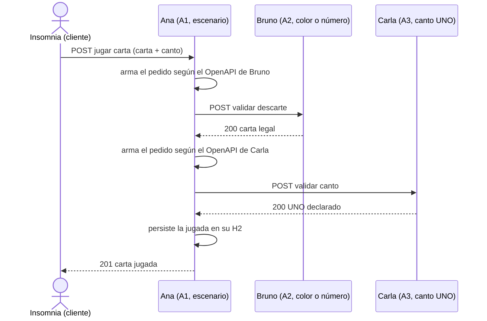
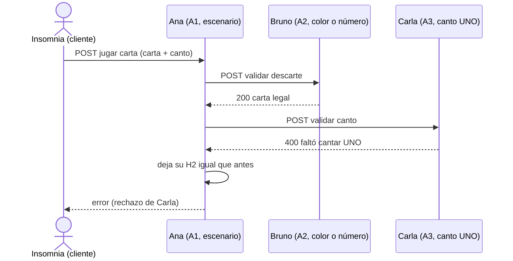

# POO-09 — Ejemplo de escenario en UNO

**Navegación:** [Enunciado](ejercicio-poo-09-apis-cruzadas-2026-11-16.md) · [Grupos](ejercicio-poo-09-grupos-2026-11-16.md) · Ejemplo UNO

El práctico de cada uno sigue en **Minecraft** o en **Counter-Strike 2**. Este diagrama usa **UNO**: mazo de colores en la mesa o en la app, una partida típica de residencia o de viaje en colectivo. Sirve para ver la forma del challenge con **otro** dominio.

Tres servicios, tres OpenAPI, dos reglas ajenas, un escenario propio.

- **Bruno** publicó una regla: la carta jugada tiene que coincidir en color o en número con la del descarte, o ser un comodín. Un 7 rojo sobre un 2 azul, sin comodín, su API rechaza.
- **Carla** publicó otra: si después de jugar queda **una** carta, hay que haber cantado UNO. Si la mano queda en una carta y el canto no vino, su API rechaza.
- **Ana** no copia esas clases. Lee los dos OpenAPI y arma **un** recurso propio, por ejemplo «jugar carta»: tira al descarte y, si queda una, lleva el canto. La jugada queda guardada en el H2 de Ana **sólo** si Bruno y Carla aceptan.

Eso es lo mismo que pedimos en Minecraft (explosiones) o en CS2 (daño o munición): un hecho del juego que necesita **las dos** validaciones de los compañeros.

## Camino feliz

El cliente de Insomnia le habla **sólo a Ana** (A1). Ana es quien llama a Bruno (A2) y a Carla (A3).

1. El cliente no conoce a Bruno ni a Carla. Conoce el escenario de Ana.
2. Ana traduce el cuerpo a lo que pide cada OpenAPI. Los nombres de ruta salen del documento de cada compañero.
3. Bruno aplica **su** regla (color, número o comodín) y responde 200.
4. Carla aplica **su** regla (canto UNO si queda una carta) y responde 200.
5. Recién entonces Ana guarda. Un `GET` posterior en el servicio de Ana muestra la mano y el descarte.

## Si una regla ajena rechaza

Bruno aceptó: el 7 rojo iba sobre un 7 verde. Carla no: quedó una carta y nadie cantó UNO. Ana deja su H2 igual que antes. El cliente ve que el rechazo vino de Carla.

En el README de Ana va, en una frase, qué hecho de UNO es «jugar carta» y qué regla tomó de cada OpenAPI. En Minecraft o CS2 el hecho será otro. La forma del diagrama es esta.

---

**Cátedra:** ale.feltes@uc.edu.py · @alefeltes
